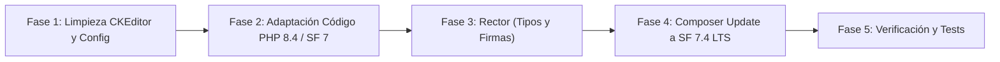

# Plan de Migración: Symfony 6.4 (PHP 8.2) → Symfony 7.4 LTS (PHP 8.4)

## Descripción del Objetivo

Llevar **AlamedaCMS** desde **Symfony 6.4 / PHP 8.2** a **Symfony 7.4 LTS / PHP 8.4** (versión instalada actualmente en el entorno CLI: `PHP 8.4.26`).

El análisis de la base de código actual (`php bin/console debug:container --deprecations` reporta **134 deprecaciones** y `lint:yaml` pasa limpio en los 39 archivos) muestra que:
1. Todas las entidades Doctrine y rutas en controladores ya usan atributos nativos de PHP 8 (`#[ORM\...]`, `#[Route]`, `#[IsGranted]`).
2. `FOSCKEditorBundle` ya fue reemplazado en todos los formularios activos por TinyMCE (`.tinymce-editor`), quedando únicamente imports sin usar y una referencia residual en `BroteType` (clase no utilizada por ningún controlador).
3. Existen algunos puntos puntuales en `src/` y `config/` que causarían errores fatales en Symfony 7.0+ y PHP 8.4 si no se actualizan antes de correr `composer update`.

---

## Decisiones que Requieren Revisión del Usuario

> [!IMPORTANT]
> **1. Eliminación definitiva de `friendsofsymfony/ckeditor-bundle`**
> Se verificó que todos los formularios activos (`EntradaType`, `PrincipalType`, `SectionFormType`, `StepOneType`, `StepTwoType`, `StepThreeType`) ya usan `TextareaType` con la clase `.tinymce-editor`. Solo `BroteType` (que no se instancia en ningún controlador) instancia `CKEditorType`. El plan propone eliminar `friendsofsymfony/ckeditor-bundle`, su configuración y el archivo de parche local.

> [!WARNING]
> **2. `ApiTokenAuthenticator` (`AbstractGuardAuthenticator`)**
> El componente `Guard` fue eliminado en Symfony 7.0. Actualmente [ApiTokenAuthenticator.php](file:///home/gerardo/Projects/AlamedaCMS/src/Security/ApiTokenAuthenticator.php) extiende `AbstractGuardAuthenticator`, aunque no está registrado en [security.yaml](file:///home/gerardo/Projects/AlamedaCMS/config/packages/security.yaml). El plan propone migrarlo a `AbstractAuthenticator` del nuevo sistema de seguridad de Symfony para que siga funcionando sin romper la carga de clases.

---

## Flujo de Migración



---

## Cambios Propuestos

### Fase 1: Desacoplar `FOSCKEditorBundle` y Limpiar Configuraciones

#### [MODIFY] [BroteType.php](file:///home/gerardo/Projects/AlamedaCMS/src/Form/BroteType.php)
* Reemplazar `CKEditorType::class` por `TextareaType::class` con `'attr' => ['class' => 'tinymce-editor']` y quitar el import de `FOS\CKEditorBundle\Form\Type\CKEditorType`.

#### [MODIFY] Formularios con imports residuales de `CKEditorType`
Quitar la línea `use FOS\CKEditorBundle\Form\Type\CKEditorType;` en:
* [EntradaType.php](file:///home/gerardo/Projects/AlamedaCMS/src/Form/EntradaType.php)
* [EntradaComplexType.php](file:///home/gerardo/Projects/AlamedaCMS/src/Form/EntradaComplexType.php)
* [PrincipalType.php](file:///home/gerardo/Projects/AlamedaCMS/src/Form/PrincipalType.php)
* [StepOneType.php](file:///home/gerardo/Projects/AlamedaCMS/src/Form/Step/Entrada/StepOneType.php)
* [StepTwoType.php](file:///home/gerardo/Projects/AlamedaCMS/src/Form/Step/Section/StepTwoType.php)
* [StepThreeType.php](file:///home/gerardo/Projects/AlamedaCMS/src/Form/Step/Section/StepThreeType.php)

#### [MODIFY] [twig.yaml](file:///home/gerardo/Projects/AlamedaCMS/config/packages/twig.yaml)
* Quitar `'resources/views/Form/ckeditor_widget.html.twig'` de `form_themes`, dejando `form_themes: ['bootstrap_5_layout.html.twig']`.

#### [MODIFY] [bundles.php](file:///home/gerardo/Projects/AlamedaCMS/config/bundles.php)
* Eliminar `FOS\CKEditorBundle\FOSCKEditorBundle::class => ['all' => true],`.

#### [DELETE] Archivos obsoletos de CKEditor
* [fos_ckeditor.yaml](file:///home/gerardo/Projects/AlamedaCMS/config/packages/fos_ckeditor.yaml)
* [ckeditor_widget.html.twig](file:///home/gerardo/Projects/AlamedaCMS/templates/resources/views/Form/ckeditor_widget.html.twig)
* [friendsofsymfony.ckeditor-bundle.updates-for-deleted-files.patch](file:///home/gerardo/Projects/AlamedaCMS/friendsofsymfony.ckeditor-bundle.updates-for-deleted-files.patch)

#### [MODIFY] [security.yaml](file:///home/gerardo/Projects/AlamedaCMS/config/packages/security.yaml)
* Eliminar `enable_authenticator_manager: true` (opción eliminada en Symfony 7.0).
* Cambiar `role:` por `roles:` en las entradas de `access_control` (líneas 59–63).

#### [MODIFY] [routes.yaml](file:///home/gerardo/Projects/AlamedaCMS/config/routes.yaml)
* Cambiar `type: annotation` por `type: attribute` en el bloque `kernel`:
```diff
 kernel:
     resource: ../src/Kernel.php
-    type: annotation
+    type: attribute
```

#### [MODIFY] [framework.yaml](file:///home/gerardo/Projects/AlamedaCMS/config/packages/framework.yaml)
* Eliminar `annotations: false` (la opción `framework.annotations` fue removida en Symfony 7.0).

---

### Fase 2: Adaptación de Clases Incompatibles con Symfony 7 y PHP 8.4

#### [MODIFY] [ApiTokenAuthenticator.php](file:///home/gerardo/Projects/AlamedaCMS/src/Security/ApiTokenAuthenticator.php)
* Migrar de `AbstractGuardAuthenticator` (eliminado en Symfony 7) a `Symfony\Component\Security\Http\Authenticator\AbstractAuthenticator` usando `SelfValidatingPassport` y `UserBadge`, y declarar `?AuthenticationException $authException = null` explícito.

#### [MODIFY] [LoginFormAuthenticator.php](file:///home/gerardo/Projects/AlamedaCMS/src/Security/LoginFormAuthenticator.php)
* Actualizar firma `start(Request $request, ?AuthenticationException $authException = null): Response` para compatibilidad con PHP 8.4.

#### [MODIFY] [EntradaVoter.php](file:///home/gerardo/Projects/AlamedaCMS/src/Security/Voter/EntradaVoter.php) y [SectionVoter.php](file:///home/gerardo/Projects/AlamedaCMS/src/Security/Voter/SectionVoter.php)
* Eliminar el import inexistente en Symfony 7 `use Symfony\Component\Security\Core\Security;`.
* Agregar los tipos requeridos por `Voter` en Symfony 7:
```diff
-    protected function supports($attribute, $subject): bool
+    protected function supports(string $attribute, mixed $subject): bool
...
-    protected function voteOnAttribute($attribute, $subject, TokenInterface $token): bool
+    protected function voteOnAttribute(string $attribute, mixed $subject, TokenInterface $token): bool
```

#### [MODIFY] [UniqueUser.php](file:///home/gerardo/Projects/AlamedaCMS/src/Validator/UniqueUser.php), [UniqueUserValidator.php](file:///home/gerardo/Projects/AlamedaCMS/src/Validator/UniqueUserValidator.php) y [UserRegistrationFormModel.php](file:///home/gerardo/Projects/AlamedaCMS/src/Form/Model/UserRegistrationFormModel.php)
* Convertir `UniqueUser` en atributo PHP 8 (`#[\Attribute(\Attribute::TARGET_PROPERTY | \Attribute::TARGET_METHOD | \Attribute::IS_REPEATABLE)]`).
* Agregar `: void` al método `validate(mixed $value, Constraint $constraint): void` en `UniqueUserValidator`.
* En `UserRegistrationFormModel`, reemplazar `@UniqueUser()` por `#[UniqueUser]`.

#### [MODIFY] [AddUserCommand.php](file:///home/gerardo/Projects/AlamedaCMS/src/Command/AddUserCommand.php) y [EntradaStatsCommand.php](file:///home/gerardo/Projects/AlamedaCMS/src/Command/EntradaStatsCommand.php)
* Agregar `: void` a `interact(InputInterface $input, OutputInterface $output): void` en `AddUserCommand` y a `configure(): void` en `EntradaStatsCommand`.

---

### Fase 3: Automatización de Tipado con Rector (PHP 8.4 + Symfony 7)

#### [MODIFY] [rector.php](file:///home/gerardo/Projects/AlamedaCMS/rector.php)
* Excluir `node_modules` de los paths de análisis.
* Configurar conjuntos de reglas para agregar `: void` en todos los `AbstractType::buildForm()`, `AbstractType::configureOptions()`, `FormTypeExtensionInterface`, y corregir parámetros implícitamente anulables (deprecación de PHP 8.4 en `ResetPasswordController`, `Entrada`, `User` y repositorios `ArticleRepository`, `BroteRepository`, `CelebracionRepository`, `EntradaRepository`, `PrincipalRepository`, `SectionRepository`, `UserRepository`).

---

### Fase 4: Actualización de Dependencias en Composer y Entorno

#### [MODIFY] [.php-version](file:///home/gerardo/Projects/AlamedaCMS/.php-version)
* Cambiar `8.2` a `8.4`.

#### [MODIFY] [composer.json](file:///home/gerardo/Projects/AlamedaCMS/composer.json)
* Subir requerimiento `"php": ">=8.4"` y actualizar `"config.platform.php": "8.4"`.
* Cambiar todos los paquetes `symfony/*` y `extra.symfony.require` a `"7.4.*"`.
* Subir `"symfony/flex"` a `"^2.4"`.
* Eliminar paquetes obsoletos:
  * `composer/package-versions-deprecated`
  * `doctrine/annotations`
  * `friendsofsymfony/ckeditor-bundle`
  * `symfony/polyfill-php72`
* Eliminar `"ckeditor:install": "symfony-cmd"` de `scripts.auto-scripts`.
* Actualizar bundles de terceros para compatibilidad con Symfony 7 y PHP 8.4:
  * `knplabs/knp-paginator-bundle`: `^6.0`
  * `knplabs/knp-time-bundle`: `^2.0` (elimina además la dependencia de `symfony/templating`)
  * `endroid/qr-code-bundle`: `^5.0 || ^6.0`
  * `ramsey/uuid-doctrine`: `^2.0`
  * `symfony/webpack-encore-bundle`: `^2.1`
  * `stof/doctrine-extensions-bundle`: `^1.12`
  * `gedmo/doctrine-extensions`: `^3.16`
  * `liip/imagine-bundle`: `^2.13`
  * `oneup/flysystem-bundle`: `^4.12`
  * `dama/doctrine-test-bundle`: `^8.0`
  * `phpunit/phpunit`: `^10.5 || ^11.0`
  * `symfony/phpunit-bridge`: `7.4.*`
  * `rector/rector`: `^1.2 || ^2.0`

---

## Plan de Verificación

### Pruebas Automatizadas
1. **Validación de Composer y resolución de árbol de paquetes:**
   ```bash
   composer validate
   composer update --with-all-dependencies
   ```
2. **Compilación de contenedor y verificación de deprecaciones:**
   ```bash
   php bin/console cache:clear
   php bin/console debug:container --deprecations
   ```
3. **Linters de configuración, contenedor, rutas y plantillas Twig:**
   ```bash
   php bin/console lint:yaml config
   php bin/console lint:container
   php bin/console lint:twig templates
   php bin/console debug:router
   ```
4. **Validación de mapeo Doctrine ORM:**
   ```bash
   php bin/console doctrine:schema:validate --skip-sync
   ```
5. **Ejecución de suite de tests PHPUnit:**
   ```bash
   php bin/phpunit
   ```

### Verificación Manual
* Iniciar servidor local (`symfony server:start` o Docker) y verificar:
  * Login en `/login` y acceso a `/admin`.
  * Creación/edición de una `Entrada` y `Section` verificando que el editor TinyMCE cargue sin errores de plantilla Twig.
